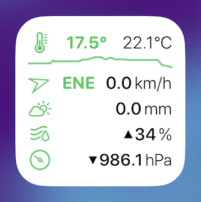
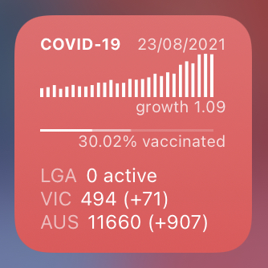
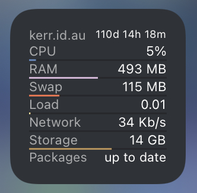
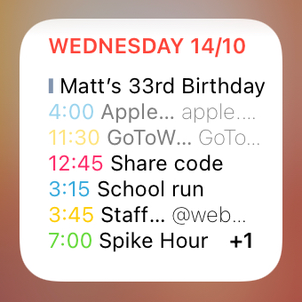

Some scripts I have written for [Scriptable](https://scriptable.app), an amazing JavaScript programming environment for iOS that supports automation, native APIs and widgets.

 

[Weather Station](https://github.com/drewkerr/scriptable/blob/main/Weather%20Station.js) widget for Ecowitt weather stations using [the API](https://doc.ecowitt.net/web/#/apiv3en?page_id=17). Shows the indoor/outdoor temperatures and a line graph of the last 6 hours, wind speed and direction, rainfall, humidity and air pressure with accurate wind vane and barometer icons.

 

[COVID-19 Cases](https://github.com/drewkerr/scriptable/blob/main/COVID-19%20Cases.js) widget using [ABC data](https://mobile.abc.net.au/news/2020-03-17/coronavirus-cases-data-reveals-how-covid-19-spreads-in-australia/12060704) and providing local case numbers in Australia. Changes colour based on weekly growth rate and tap to show more data in a table view. Edit the source to change the local/state area. Users elsewhere might get some ideas for how to draw a column graph.

 

[Bible Verse of the Day](https://github.com/drewkerr/scriptable/blob/main/Bible.js), a simple widget that displays a verse of the day from the English Standard Version. Running the script will open the passage in the ESV Bible app.

 

[Sticky Note](https://github.com/drewkerr/scriptable/blob/main/Sticky%20widget.js), a simple widget that includes tap to edit, dark mode support and file-based storage.

 

[Linode Longview](https://github.com/drewkerr/scriptable/blob/main/Linode.js), a widget that displays Longview server stats. Running the script will open Longview. To configure, [create a Personal Access Token](https://cloud.linode.com/profile/tokens) with read-only access to Longview and edit the script to add the token.

 

[Calendar](https://github.com/drewkerr/scriptable/blob/main/Calendar%20widget.js) widget in the style of [Things](https://culturedcode.com/things/)' today view. If events don't fit, it prioritises all-day over future over past events (which are greyed out) and indicates how many extra events are scheduled.
